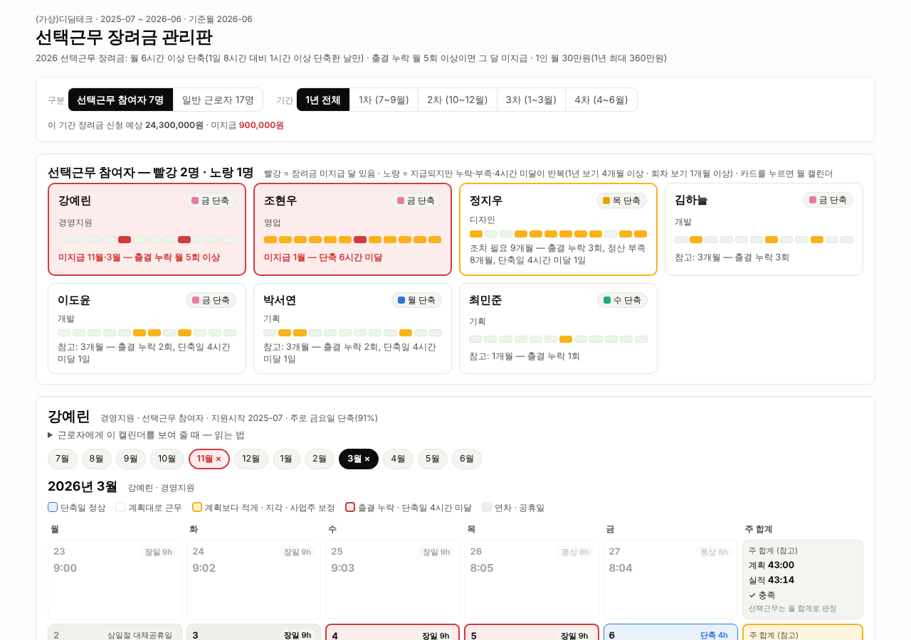

# 전자출결 시계열로 본 선택근무 장려금·근로시간 점검

코디세이 AI 실무 과정 「AI 데이터 분석: 데이터 기반 트렌드 분석」 과제 제출물입니다. (작성: DOl, 디딤돌파트너스)

회사 직원들의 **매일 출퇴근 기록(시계열)**을 분석했습니다. 다음 세 가지를 판별합니다.
- 정해진 근무시간을 채웠는지(근로기준법)
- 선택근무를 제대로 했는지
- **2026 유연근무 장려금(선택근무)**을 받을 수 있는지

판별 결과로 근로자별 **월 출결 캘린더**를 만들어 담당자와 근로자가 바로 고칠 수 있게 했습니다.

- 📄 **분석 리포트: [REPORT.md](REPORT.md)** — 주제, 질문, 데이터, 정제, 시각화 7개, 인사이트 5개, 결론·한계, AI 사용 로그
- 📓 실행 노트북: [analysis.ipynb](analysis.ipynb) (실행 결과 포함)
- 📊 대시보드: `dashboard/index.html` (더블클릭, 서버·인터넷 불필요) · 배포 https://claude.ai/artifact/RtCWCb64f4mjq3fCyPXKPj · 시나리오 [docs/DASHBOARD.md](docs/DASHBOARD.md)
- 🗓 근로자별 캘린더 리포트: [reports/workers/](reports/workers/) · 기업 보고서: [reports/company_progress_report.md](reports/company_progress_report.md)



## 과제 요구사항 대응표

| 요구사항 | 위치 |
|---|---|
| 시계열 데이터 100개 이상, 출처·기간 | 출퇴근 기록 5,620건, 근무일 245일, 2025-07-01 ~ 2026-06-30 — REPORT 3장, [data/README.md](data/README.md) |
| 분석 질문 3개 이상 | 4개 — REPORT 2장 |
| 기본 정보·결측치·이상치 처리 | REPORT 3-2, 4-1 |
| 시계열 기법 2개 이상 | 주·월 집계, 누적 비중, 8주 이동평균, 기준선 비교, 전월 대비 변화율 — REPORT 4-4~4-6 |
| 트렌드·계절성·노이즈 설명 | REPORT 4-5 |
| 시각화 2개 이상(권장 3개) | 그래프 7개 (`images/`) + 캘린더 화면 |
| 인사이트 3개 이상(관찰·해석 구분) | 5개 — REPORT 6장 |
| 결론·한계점 | REPORT 8장 |
| Python 코드 | `src/*.py`, `analysis.ipynb` |
| 재현성(의존성·실행 방법·출처·라이선스) | `requirements.txt`, 아래 실행 방법, [data/README.md](data/README.md) |
| AI 사용 로그 | REPORT 11장 |
| 보너스: 대시보드 | 배포 URL + 스크린샷 + 시나리오 [docs/DASHBOARD.md](docs/DASHBOARD.md) |
| 보너스: 분해·예측 | 그래프 ⑥ 추세·계절성·잡음 분해, ⑦ 베이스라인 예측 — REPORT 5장 |

## 사례 (합성 데이터)

(가상)디딤테크 24명, 2025-07 ~ 2026-06 (장려금 지원 기간 1년)
- **일반 근로자 17명**: 09:00~18:00, 휴게 12~13시 → 1일 8시간·주 40시간
- **선택근무 참여자 7명**(장려금 지원대상)
  - 장일 09:00~19:00(9시간) × 4일 + 단축일 09:00~13:30(휴게 12:00~12:30, 4시간) × 1일 = 주 40시간
  - 정산기간 1개월, 근무계획표 `data/work_plan.csv`
- **2026 장려금 기준**: 월 6시간 이상 단축(1일 8시간 대비 1시간 이상 단축한 날만), 출결 누락 월 5회 이상이면 그 달 미지급, 1인 월 30만원(1년 최대 360만원)

## 폴더 구조
```
├── REPORT.md · README.md · analysis.ipynb · requirements.txt
├── results.json / results_eligibility.json   리포트 수치 원본
├── config/requirements_2026.json   근무시간표·허용 오차·장려금·법 기준값 (숫자만 고치면 재계산)
├── data/
│   ├── attendance_logs.csv  출퇴근 기록 5,620건 (합성, 이음24 전자출결 형식)
│   ├── work_plan.csv        선택근무 근무계획표 (장일·단축일·통상)
│   ├── leave.csv · roster.csv · employees.csv · holidays_kr.csv
│   └── processed/           일별 패널, 주·월 집계, 판정 결과
├── images/                  그래프 ①~⑦
├── src/
│   ├── generate_data.py     합성 데이터 생성 (시드 고정)
│   ├── attend_engine.py     이음24 출결 엔진(휴게 차감 등) 이식본
│   ├── verify_engine.py     원본 JS 엔진과 교차검증
│   ├── analysis.py          정제·일/주/월 집계·단축 요일 선호·분해·예측·그래프 ①②③⑥⑦
│   ├── eligibility.py       장려금 판정·회차별 금액·명부 점검·그래프 ④⑤
│   └── build_reports.py     캘린더 데이터·근로자 리포트·기업 보고서·대시보드 데이터
├── reports/                 근로자별 월 캘린더 리포트(HTML), 기업 보고서
├── dashboard/               index.html + calendar.js·calendar.css + data.js
└── docs/                    대시보드 시나리오, 스크린샷
```

## 실행 방법 (Python 3.10 이상)
```bash
pip install -r requirements.txt
python src/generate_data.py          # 1. 합성 데이터 생성 (같은 시드 → 같은 파일)
python src/verify_engine.py          # 2. 출결 엔진 교차검증 (원본 JS는 비공개 저장소에 있어 이 저장소에서는 건너뜀)
python src/analysis.py               # 3. 정제·집계·그래프
python src/eligibility.py            # 4. 장려금 판정·그래프
python src/build_reports.py          # 5. 캘린더 리포트·기업 보고서·대시보드 데이터 (기준월 지정: ... 2026-03)
```
또는 `jupyter notebook analysis.ipynb` 를 열고 위에서부터 실행합니다.
검증 환경: Python 3.13.16, pandas 3.0.5, numpy 2.5.3, matplotlib 3.11.2, node 22.

## 시연 방법
1. `dashboard/index.html` 더블클릭
2. 빨간 테두리 카드 **조현우** → **1월**: 단축일을 1번만 써서 미지급된 달, 빨간 칸(퇴근 버튼 누락)과 '문안 복사'
3. **강예린 → 11월**: 출결 누락 8회로 미지급
4. 기간을 **1~4차**로 바꾸고 **일반 근로자** 탭(홍가을 2월: 조퇴로 주 40시간 부족)
5. 아래 **단축 요일 선호**: 금요일 오후 평균 3.9명 부재
6. 근로자 개인용: `reports/workers/1_선택근무/E07_조현우.html` (Ctrl+P 인쇄)

## 데이터 출처·라이선스·주의
- 모든 인물·기업·기록은 `src/generate_data.py`로 만든 **합성 데이터**입니다(이름은 `(가상)` 가명). 실제 고객사 출결은 개인정보라 사용하지 않았습니다. 직접 생성했으므로 제3자 권리가 없습니다.
- 출퇴근 기록 형식은 이음24 전자출결과 같아서, 실제 데이터를 같은 형식으로 넣으면 그대로 분석됩니다.
- 장려금 기준 출처: 2026년 일·가정 양립 환경개선 지원 사업 운영 내용, 사업계획서 별지 유의사항, [고용24 제도 안내](https://m.work24.go.kr/cm/c/f/1100/selecSystInfo.do?systId=SI00000345&systClId=SC00000308)
- 계산은 판단 보조용입니다. 장려금 지급 여부는 고용센터 심사로, 근태·임금 처리는 회사가 결정합니다.
