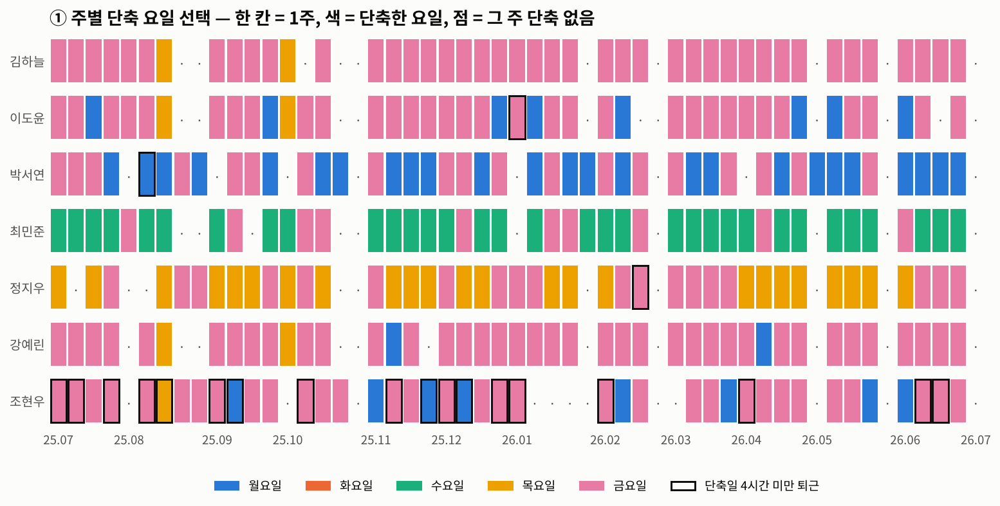
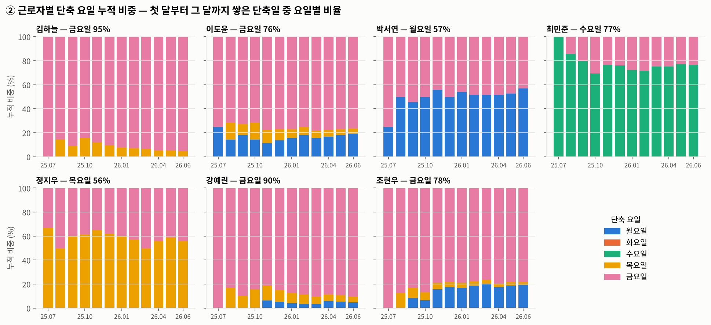
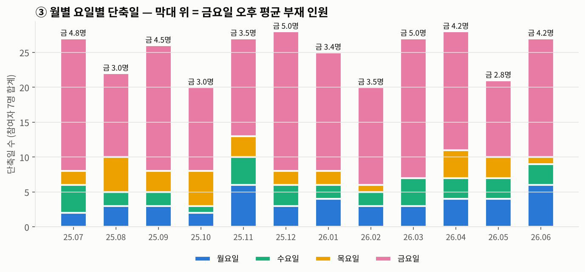
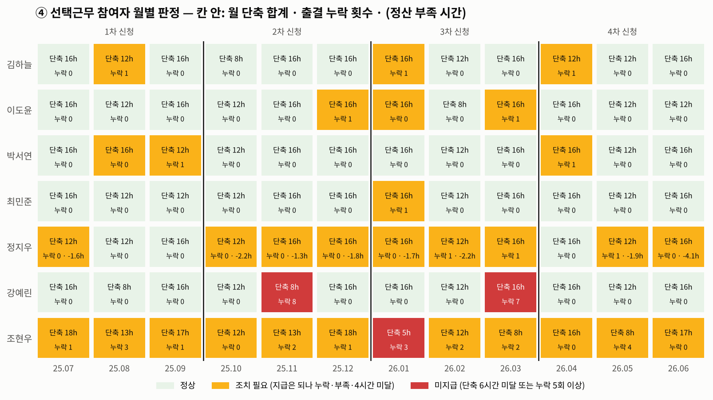
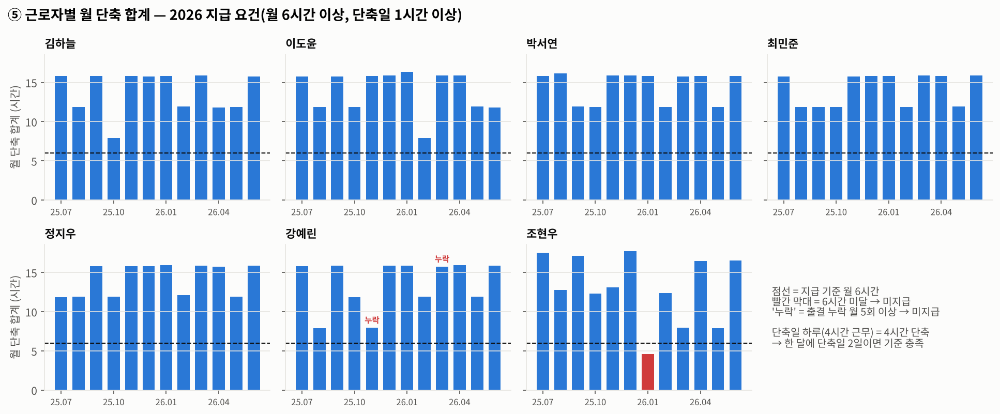
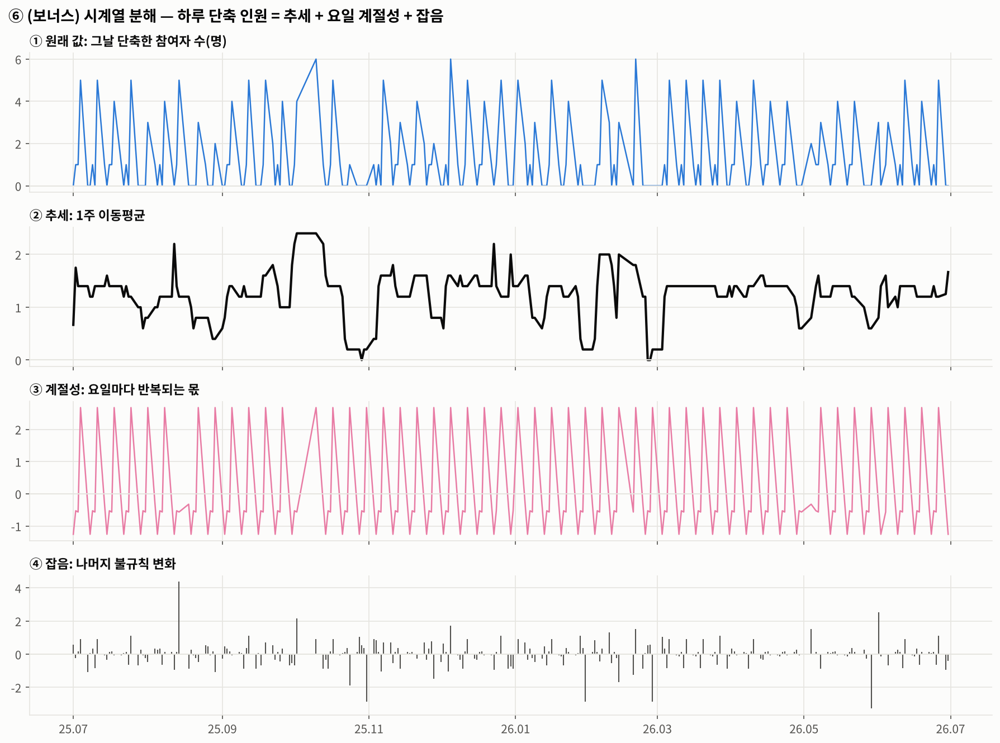
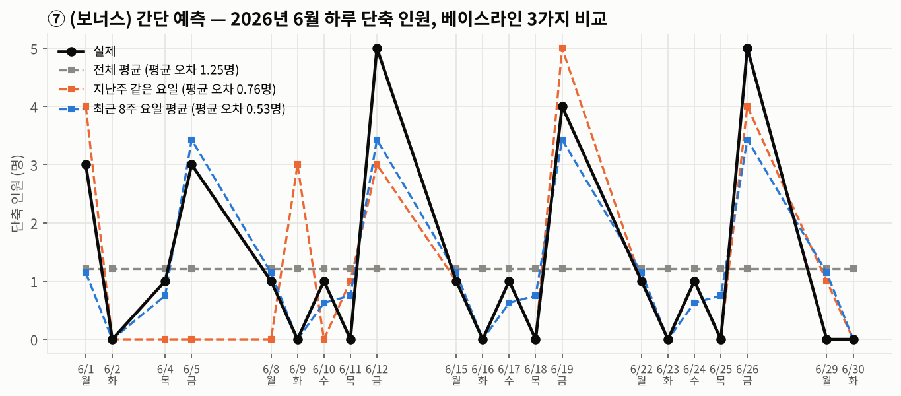
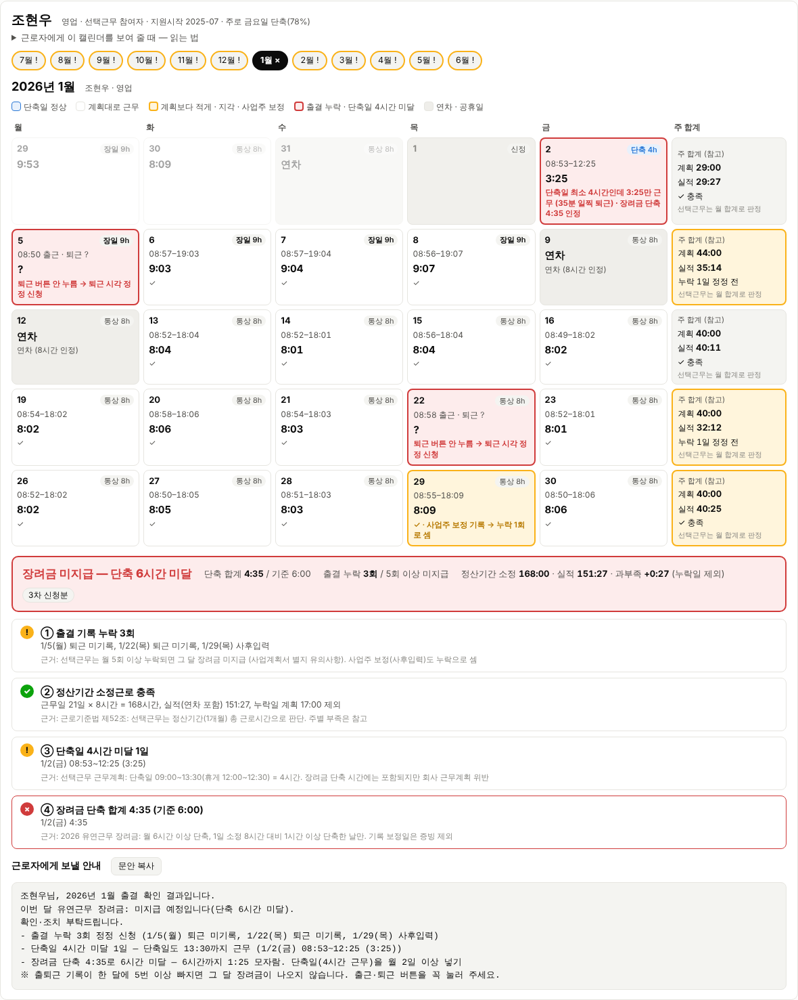

# 전자출결 시계열로 본 선택근무 장려금·근로시간 점검 리포트

> 코디세이 AI 실무 과정 「AI 데이터 분석: 데이터 기반 트렌드 분석」 · 작성: DOl (디딤돌파트너스) · 2026-10-18
> 모든 인물·기업·기록은 **합성 데이터**입니다. 실제 고객 출결은 개인정보이므로 쓰지 않았습니다.
> 계산은 판단 보조용입니다. 장려금 지급 여부는 고용센터 심사로, 근태·임금 처리는 회사가 결정합니다.

## 0. 한눈에 보기

| 항목 | 내용 |
|---|---|
| 데이터 | (가상)디딤테크 24명의 전자출결 5,620건. 기간은 2025-07-01 ~ 2026-06-30이며 근무일 245일, 주 53개, 정산기간 12개 |
| 사례 | 일반 근로자 17명은 9 to 6(1일 8시간·주 40시간)입니다. 선택근무 참여자 7명은 장일 9시간 + 단축일 4시간(휴게 12:00~12:30)으로 일합니다 |
| 기준 | **2026 유연근무 장려금(선택근무)**: 월 6시간 이상 단축하되, 1일 8시간보다 1시간 이상 적게 일한 날만 단축으로 셉니다. 출결 누락이 월 5회 이상이면 그 달은 미지급입니다. 지원금은 월 30만원, 1년 최대 360만원입니다 |
| 기법 | ① 리샘플링(일 → 주·정산기간) ② 누적 비중(expanding) ③ 8주 이동창(이동평균) ④ 기준선 대비 월별 추이 ⑤ 전월 대비 변화율 ⑥ (보너스) 추세·계절성·잡음 분해, 베이스라인 예측 |
| 결과 | 참여자 84인·월 가운데 지급 81, 미지급 3입니다. 예상 지급액은 2,430만 원(최대 2,520만 원)입니다. 미지급 3건 중 2건은 **출결 누락이 한 달에 몰린 경우**이고, 1건은 **단축일을 거의 쓰지 않은 달**입니다 |
| 실무 산출물 | 참여자 목록(문제 근로자 빨간 테두리) → 클릭하면 **월 출결 캘린더**가 열립니다. 근로자별 1년치 캘린더 리포트 24개와 기업 보고서도 만들었습니다 |

## 1. 분석 주제 및 선정 이유

디딤돌파트너스는 중소기업의 유연근무 도입과 정부 지원금 신청을 돕습니다. 후보 셋을 비교했습니다.

| 후보 | 시계열 데이터 | 판단 |
|---|---|---|
| 시니어인턴십 | 참여자 월별 근무 | 기관 단위 집계라 개인 시계열이 짧음 |
| 청년일자리도약장려금 | 채용 후 근속 월수 | 사건(입사·퇴사) 중심이라 추세 분석이 약함 |
| **일·생활 균형(유연근무) 장려금 — 선택근무** | **매일 출퇴근 기록** | 근로자 × 하루 단위 기록이 1년 쌓이고, 장려금 요건과 근로기준법 판단이 모두 그 기록에서 나옴 → **채택** |

이음24 프로젝트의 전자 출결 기능(출근·퇴근 버튼, 서버 시각 기록)과 근로시간 계산 엔진을 그대로 활용할 수 있다는 점도 선정 이유였습니다.

실무에서 가장 큰 문제는 두 가지입니다. 하나는 **근로자가 지침을 모른 채 출결을 빠뜨리거나 시간을 못 채우는 것**이고, 다른 하나는 **담당자가 그 사실을 월말 신청 때에야 아는 것**입니다. 그래서 이 분석의 목표를 '근로자와 담당자가 같은 월 캘린더를 보고 바로 고칠 수 있게 하는 것'으로 잡았습니다.

## 2. 분석 질문

- **Q1.** 근로자별 하루·주·정산기간 실근로시간이 근무계획(소정근로시간)을 채웠나? 일반 근로자는 근로기준법 제50조, 선택근무는 제52조 기준으로 봅니다.
- **Q2.** 장려금 미지급과 근태 문제는 어떤 사유로, 누구에게, 언제 생기나? 사유는 ① 전자출결 누락 ② 소정근로시간 부족 ③ 단축일 최소 근로시간(4시간) 미달입니다.
- **Q3.** 선택근무 참여자는 어느 요일을 단축일로 쓰나? 한 주 데이터로는 흔들리니, 월 단위로 누적하면 선호가 굳어지나?
- **Q4.** 같은 요일 오후에 몇 명이 빠지나? 업무 배치에서 무엇을 조정해야 하나?

## 3. 데이터 설명

### 3-1. 출처: 합성 데이터 (`src/generate_data.py`, 시드 20261018)

| 파일 | 행 | 내용 |
|---|---:|---|
| `attendance_logs.csv` | 5,620 | `emp_id, d, in, out, edited, edit_reason` — 이음24 전자 출결 형식(ISO 8601 +09:00). `out` 공란 = 퇴근 미기록, `edited=1` = 사업주 사후입력 |
| `work_plan.csv` | 1,715 | **선택근무 근무계획표** — 날짜별 장일(9h)·단축일(4h)·통상(8h). 달마다 합계가 근무일 × 8시간이 되도록 맞춤 |
| `leave.csv` | 188 | 승인 연차 대장. 연차일은 그날 계획 시간만큼 인정 |
| `roster.csv` · `employees.csv` | 24 | 관리구분(지원대상/일반), 지원시작월, 보수, 고용보험, 사업주 가족, 국적·체류, 입·퇴사일 |
| `holidays_kr.csv` | 16 | 공휴일·대체공휴일·근로자의 날 |

- **기간**: 2025-07-01 ~ 2026-06-30 (장려금 지원 1년)
- **시점 수**: 근무일 245일 × 24명. 일 단위 패널은 5,798행입니다.
- **라이선스**: 직접 생성한 데이터로 제3자 권리가 없습니다. 인물명은 모두 `(가상)` 가명입니다.

**생성 가정** (현실처럼 '대부분은 정상, 문제는 몇 명에게 몰림'으로 설계)
- 기본 습관: 출근 08:50 전후. 누락 확률은 하루 0.4~0.8%, 지각 약 1%입니다.
- 정지우: 장일(9시간)인데 18시대에 퇴근하는 습관이 있습니다(28%).
- 강예린: 바쁜 달(2025-11, 2026-03)에 퇴근 버튼 누락이 몰립니다.
- 조현우: 단축일 13:30 전 퇴근(35%), 누락이 잦고, 2026-01 성수기에는 단축일을 1번만 썼습니다.
- 일반 근로자: 서준혁은 지각, 송민재는 퇴근 미기록, 홍가을은 조퇴가 잦습니다.

**한계**: 수치는 분석 방법을 검증하려는 것이며, 실제 기업의 행동을 보여 주는 증거가 아닙니다(8장).

### 3-2. 기본 점검

- 같은 날 기록이 2건 이상인 경우가 14건 있었습니다. 1분짜리 오입력 기록이 섞인 것입니다.
- 퇴근 공란 38건, 사후입력 33건, 승인 연차 188일이 있었습니다.

## 4. 정제와 분석 방법

### 4-1. 결측·이상치 처리

| 유형 | 건수 | 처리 | 이유 |
|---|---:|---|---|
| 퇴근 미기록(결측) | 38 | 근로시간 계산에서 빼고 **① 출결 누락**으로 셈 | 근무시간을 알 수 없음. 추정해서 채우면 장려금 증빙이 되지 않음 |
| 16시간 이상 체류(이상치) | 4 | 계산에서 빼고 ① 누락으로 셈 | 전날 퇴근을 다음 날 아침에 누른 것 |
| 10분 미만 기록(오입력) | 14 | 버림 | 버튼을 잘못 누른 것. 같은 날 정상 기록이 따로 있음 |
| 기록·연차 모두 없는 근무일 | 4 | ① 누락(기록 없음) | 근무했는지 결근했는지 확인이 필요함 |
| 사업주 사후입력 | 33 | 근로시간에는 반영하되 **장려금 단축 증빙에서는 제외**. 선택근무는 누락 횟수에 셈 | 별지 유의사항상 전자 기록 누락에 해당 |

누락일은 ② 소정근로 부족 계산에서 뺍니다. 같은 날을 '누락'과 '부족'으로 두 번 문제 삼지 않기 위해서입니다. 이전 버전에서는 누락일이 0시간으로 잡혀 부족이 크게 부풀려졌습니다.

### 4-2. 근로시간 계산 — 이음24 출결 엔진 그대로

`js/attend-analyze.js`의 휴게 차감, 소정 출근 전 시간 제외, 여러 기록 합산 로직을 Python으로 옮겼습니다(`src/attend_engine.py`). 원본 JS와 22,424건을 모두 대조했고 **불일치는 0건**입니다.

휴게는 근로기준법 제54조를 따릅니다. 9시간 근무일은 1시간, 4시간 근무일은 30분(12:00~12:30)을 뺍니다.

### 4-3. 판정 기준 (`config/requirements_2026.json` — 숫자만 고치면 재계산)

| 단위 | 일반 근로자 | 선택근무 참여자 |
|---|---|---|
| 하루 | 통상 8시간 대비 (5분 허용) | 근무계획표(장일 9·단축 4·통상 8) 대비. 단축일 4시간 미만이면 ③ |
| 주 | **주 소정 40시간 판정**(공휴일 주는 근무일 × 8시간, 30분 허용) | 근무계획 합계 대비 **참고** |
| 월 | 부족 주·누락·지각 | **정산기간 판정**: 근무일 × 8시간 대비(1시간 허용) |
| 장려금 | – | 월 단축 합계 6시간 이상(1시간 이상 단축한 날, 기록 온전한 날만) AND 누락 월 5회 미만 |

월 판정 단계

| 구분 | 빨강 | 노랑 | 정상 |
|---|---|---|---|
| 선택근무 | **미지급** | **조치 필요**: 지급은 되지만 ①②③ 중 하나라도 있음 | 정상 |
| 일반 | **확인 필요**: 미정정 누락 3회 이상, 부족 주 2주 이상, 52시간 초과 | **주의** | 정상 |

### 4-4. 시계열 기법

1. **리샘플링**: 일 → 주(월~금) → 정산기간(월)으로 합쳤습니다. 같은 근로시간 데이터라도 판정 단위에 따라 결론이 달라지는 것을 확인했습니다(인사이트 3).
2. **누적 비중(expanding)**: 근로자별로 첫 달부터 그 달까지 쌓인 단축일의 요일별 비율을 봤습니다. 한 주 단위의 흔들림을 줄여 선호가 언제 굳어지는지 봅니다(그래프 ②).
3. **8주 이동창(rolling)**: 최근 8주 중 주 선호 요일을 쓴 비율을 봤습니다. 선호가 얼마나 일관된지 재는 지표입니다.
4. **기준선 대비 월별 추이**: 월 단축 합계를 6시간 기준선과 비교했습니다(그래프 ⑤). 누락이 특정 달에 몰리는 패턴도 봤습니다(그래프 ④).
5. **변화율(전월 대비)**: 참여자 전체의 월별 출결 누락 횟수가 전달보다 몇 % 늘었는지 계산했습니다. 평소 0~5회이던 것이 몇 % 튀는지 보면 '이상한 달'이 바로 드러납니다(4-6 표).
6. **(보너스) 시계열 분해와 간단 예측**: 하루 단축 인원을 추세 + 요일 계절성 + 잡음으로 나눴습니다(그래프 ⑥). 그리고 6월을 베이스라인 3가지로 예측했습니다(그래프 ⑦).

**집계 단위를 고른 이유**: 일반 근로자는 근로기준법이 '주 40시간'으로 판단하므로 주 단위로 봤습니다. 선택근무는 '정산기간(1개월) 합계'로 판단하고 장려금도 월 단위로 지급하므로 월 단위로 봤습니다. 단축 요일 선호는 한 주로는 흔들려서 월 단위 누적으로 봤습니다.

### 4-5. 트렌드·계절성·노이즈 — 이 데이터에서는 무엇인가

| 개념 | 뜻 | 이 데이터의 예 |
|---|---|---|
| **트렌드(추세)** | 시간이 지나며 한 방향으로 움직이는 큰 흐름 | 박서연의 월요일 단축 누적 비중이 25% → 50% → 57%로 올라가 굳어짐(그래프 ②). 하루 단축 인원의 1주 이동평균은 대체로 1.2~1.6명에서 움직이다가, 추석·설 연휴 주에는 0 근처로 떨어짐(그래프 ⑥-②) |
| **계절성(주기)** | 일정한 간격으로 반복되는 패턴 | **요일 주기**: 금요일은 평균보다 +2.7명, 화요일은 −1.3명(그래프 ⑥-③). 연차는 8월 초·연말·명절 앞뒤에 몰림 |
| **노이즈(잡음)** | 규칙 없이 흔들리는 작은 변화 | 출근 시각이 매일 몇 분씩 다름. 분해 후 남은 잡음의 표준편차는 0.78명으로, 원래 값 흔들림(1.65명)의 절반 이하. 잡음이 가장 큰 날(2025-08-14 목 +4.4명)은 광복절 앞날이라 금요일 단축을 목요일로 당긴 날 |

### 4-6. 변화율 — 참여자 월별 출결 누락 (전월 대비)

| 월 | 25.07 | 08 | 09 | 10 | **11** | 12 | 26.01 | 02 | **03** | 04 | 05 | 06 |
|---|---|---|---|---|---|---|---|---|---|---|---|---|
| 누락 횟수 | 1 | 4 | 2 | 0 | **10** | 2 | 5 | 3 | **11** | 2 | 5 | 0 |
| 전월 대비 | – | +300% | −50% | −100% | (0→10) | −80% | +150% | −40% | **+267%** | −82% | +150% | −100% |

평소에는 0~5회 사이를 오가는데, 11월과 3월에만 10회를 넘깁니다. 두 달 모두 강예린 한 명에게 누락이 몰린 달이고, 미지급으로 이어졌습니다. 다만 누락 횟수 자체가 작아서 변화율(%)이 크게 출렁이므로, 변화율만으로 판단하지 않고 **횟수와 함께** 봐야 합니다.

## 5. 분석 결과와 시각화

### ① 주별 단축 요일 선택 (Q3)


한 칸은 1주입니다. 김하늘(금)과 최민준(수)은 거의 한 색이지만, 박서연(월·금)과 정지우(목·금)는 주마다 섞입니다. 굵은 테두리는 단축일에 4시간을 채우지 않고 퇴근한 주로, 조현우에게 몰려 있습니다. 점(단축 없는 주)은 전체 주의 20%입니다. 대부분 공휴일 주이거나, 월 합계를 맞추려고 계획에서 단축일을 통상(8h)으로 돌린 주입니다.

### ② 근로자별 단축 요일 누적 비중 (Q3)


월 단위로 쌓으면 선호가 드러납니다.

| 근로자 | 주 선호 | 1년 비중 | 8주 이동창 최저 | 누적 비중이 최종값 ±5%p 안에 든 달 |
|---|---|---:|---:|---|
| 김하늘 | 금 | 95% | 67% | 2025-07 (첫 달부터) |
| 이도윤 | 금 | 76% | 50% | 2025-07 |
| 박서연 | 월 | 57% | 25% | 2025-11 (5개월째) |
| 최민준 | 수 | 77% | 40% | 2025-09 |
| 정지우 | 목 | 56% | 14% | 2025-09 |
| 강예린 | 금 | 91% | 67% | 2025-09 |
| 조현우 | 금 | 78% | 57% | 2025-11 |

### ③ 월별 요일별 단축일 (Q4)


전체 단축일 가운데 금요일이 64%, 월 14%, 수 11%, 목 10%이고 화요일은 0입니다. 금요일 오후에는 7명 중 **평균 3.9명**이 자리에 없습니다.

### ④ 참여자 월별 판정표 (Q2)


빨강 3칸은 강예린 2025-11(누락 8회)과 2026-03(누락 7회), 조현우 2026-01(단축 4:35)입니다. 노랑이 계속 이어지는 사람은 조현우와 정지우 둘뿐입니다.

### ⑤ 근로자별 월 단축 합계와 6시간 기준선 (Q2)


단축일 4일인 달은 약 16시간, 3일인 달은 약 12시간이라 기준(6시간)보다 2~2.6배 여유가 있습니다. 기준선 아래로 내려간 것은 조현우 1월 한 번뿐입니다.

### ⑥ (보너스) 시계열 분해 — 하루 단축 인원 (Q3·Q4)


방법은 덧셈 분해입니다. 원래 값 = ② 추세(5근무일 중심 이동평균) + ③ 요일 계절성((값 − 추세)의 요일별 평균) + ④ 잡음(나머지)입니다. 요일 계절성이 가장 크게 나타나며, 금요일이 +2.7명입니다. 이것으로 '금요일 단축'이 우연이 아니라 매주 반복되는 구조라는 것을 확인했습니다. 잡음이 큰 날은 대부분 공휴일 앞뒤라서, 단축 요일을 옮긴 날입니다.

### ⑦ (보너스) 간단 예측 — 2026년 6월 하루 단축 인원 (Q4)


2025-07~2026-05로 학습하고 6월 21근무일을 예측했습니다.

| 베이스라인 | 방법 | 평균 오차 |
|---|---|---:|
| 전체 평균 | 1년 평균을 매일 그대로 사용 | 1.25명 |
| 지난주 같은 요일 | 일주일 전 같은 요일 값을 그대로 사용 | 0.76명 |
| **최근 8주 요일 평균** | 최근 8주의 같은 요일 평균 | **0.53명** |

요일을 반영한 방법이 오차를 절반 이하로 줄였습니다. 이것도 요일 계절성이 강하다는 뜻입니다.

- **가정**: 다음 달도 지난 8주와 같은 요일 습관이 이어진다.
- **한계**:
  - 공휴일이 낀 주는 단축 요일이 옮겨지므로 틀립니다(6/3 지방선거일 주).
  - 근로자 수가 7명뿐이라 한 명의 변화가 크게 영향을 줍니다.
  - 실무에서는 월초에 받는 근무계획표가 예측보다 정확하므로, 이 예측은 '계획표가 없을 때 금요일 오후 인력 공백을 미리 가늠하는 용도'로만 씁니다.

### ⑧ 월 출결 캘린더 (실무 화면, Q1·Q2)


하루 칸에는 계획, 출퇴근 시각, 실근로, 문제와 할 일이 들어갑니다. 주 줄에는 계획 대비 실적이, 월 아래에는 장려금 판정, 점검 4항목, 근로자에게 보낼 문안이 붙습니다.

## 6. 인사이트

### 인사이트 1. 문제는 소수에게 몰린다 — 전체 건수보다 '누가'를 봐야 한다
- **관찰**: 참여자 출결 누락 45회 가운데 34회(76%)가 강예린·조현우 두 명에게서 나왔습니다. 단축일 4시간 미달 21일 중 18일은 조현우입니다. 정산기간 부족 8개월은 모두 정지우입니다. 일반 근로자 17명 중 노랑·빨강 달이 4개월 이상인 사람은 홍가을(9), 서준혁(6), 송민재(4) 세 명뿐입니다.
- **해석(가설)**: '전체 미충족 건수' 지표는 한두 명의 습관에 끌려 다닙니다. 담당자에게 필요한 것은 근로자 목록에서 문제 근로자를 바로 찾는 것입니다. 그래서 관리판 첫 화면을 집계 지표 대신 참여자 카드 목록으로 바꿨습니다. 빨강은 미지급 달이 있는 사람, 노랑은 1년 중 4개월 이상 반복되는 사람입니다.

### 인사이트 2. 2026 기준에서 장려금을 날리는 건 '단축 부족'보다 '출결 누락'이다
- **관찰**: 단축일 하루가 4시간 단축이라 월 단축 중앙값이 15.8시간입니다. 기준 6시간 미달은 성수기에 단축일을 1번만 쓴 1건뿐입니다. 반면 강예린은 평소 누락이 거의 없다가, 바쁜 두 달에 각각 8회와 7회가 몰려 그 두 달이 미지급되었습니다(60만 원).
- **해석**: 연간 누락 횟수가 아니라 **월별 누락의 몰림**이 위험 신호입니다. 월 3회에 이르면 그 달 안에 경고해야 막을 수 있습니다. 그래서 캘린더에 누락일을 빨간 칸으로 표시하고 '정정 신청'을 바로 적었습니다. 사업주 사후입력도 누락으로 세기 때문에(별지) 사후 보정으로는 구제되지 않습니다.

### 인사이트 3. 같은 근로시간도 '주 단위'로 보면 문제처럼 보이고, '정산기간'으로 보면 정상이다
- **관찰**: 선택근무 371주 중 계획보다 30분 넘게 부족한 주가 28주입니다. 그중 20주가 정지우입니다. 나머지 근로자는 월 합계로 보면 모두 충족했습니다. 일반 근로자는 주 40시간 부족 20주 중 12주가 조퇴가 잦은 홍가을입니다.
- **해석**: 선택근무는 근로기준법 제52조상 정산기간 합계로 판단해야 하고, 주 단위는 참고용입니다. 다만 정지우처럼 장일마다 30분 남짓 일찍 나가는 습관(장일 172일 중 49일)은 주 단위에서 먼저 보입니다. 그래서 캘린더에 두 단위를 함께 두되, 선택근무 주 합계에는 '참고 — 판정은 월 합계'를 붙였습니다. 이 부족은 장려금에는 영향이 없지만 임금(결근 공제)이나 근무계획 보충 문제이므로, 장려금 판정과 따로 표시합니다.

### 인사이트 4. 단축 요일 선호는 한 주로는 안 보이고, 3~5개월 누적하면 굳어진다
- **관찰**: 누적 비중이 최종값 ±5%p 안에 드는 시점이 김하늘·이도윤은 첫 달, 최민준·정지우·강예린은 3개월째, 박서연·조현우는 5개월째입니다. 8주 이동창으로 보면 박서연은 최저 25%, 정지우는 14%까지 떨어집니다.
- **해석**: 인사 배치에 반영하려면 최소 한 분기(3개월, 1회 신청 단위)의 누적치를 보는 것이 맞습니다. 선호가 섞이는 사람(박서연·정지우)은 고정 요일을 정하지 말고 월초 근무계획표로 받는 편이 현실적입니다.

### 인사이트 5. 금요일 오후 공백 — 단축 요일을 나눌 여지가 있다
- **관찰**: 단축일의 64%가 금요일이고, 금요일 오후에는 평균 3.9명(7명 중)이 빠집니다. 화요일을 쓰는 사람은 없습니다.
- **해석**: 금요일 오후 회의나 고객 응대가 몰리는 부서라면 공백이 생깁니다. 이미 월·수·목을 쓰는 사람(박서연·최민준·정지우)이 있으므로, 같은 부서 안에서 요일을 나누도록 조정할 수 있습니다. 개발 부서의 김하늘·이도윤은 둘 다 금요일입니다.

## 7. 실무 산출물

| 무엇 | 누가 쓰나 | 위치 |
|---|---|---|
| 관리판 — 참여자 목록(빨강·노랑 테두리) → 클릭 → 월 출결 캘린더 + 판정 + 문안 복사, 단축 요일 선호 | 기업 담당자, 고용센터 검토 | `dashboard/index.html` |
| 근로자별 1년치 캘린더 리포트 (인쇄 가능, 읽는 법 포함) | 근로자 본인 | `reports/workers/1_선택근무/`, `2_일반/` |
| 기업 보고서 — 회차별 판정·금액, 집중 관리 근로자, 단축 요일 선호, 일반 근태, 명부 점검 | 대표·담당자 | `reports/company_progress_report.md` |
| 판정 원본 | 재확인 | `data/processed/monthly.csv`, `eligibility_monthly.csv` |

## 8. 결론 및 한계점

**결론**

1. 2026 기준(월 6시간 단축)에서 근무계획대로 단축일을 쓰면 단축 요건은 여유 있게 충족됩니다. 장려금을 지키는 핵심은 **월별 출결 누락 관리**입니다.
2. 근로시간 부족은 '누락으로 인한 겉보기 부족'과 '실제 덜 일함'을 나눠야 합니다. 누락일을 빼고 보면 실제 부족은 특정 근로자의 습관(장일 조기 퇴근, 조퇴)에서만 나옵니다.
3. 근로자에게는 규정 설명보다 **자기 달력에 빨간 칸과 할 일이 적힌 화면**이 더 효과적일 것으로 봅니다. 이 효과는 아직 검증 전입니다.

**한계**

- **합성 데이터**입니다. 비율은 가정에서 나왔으므로, 실제 고객사 데이터로 다시 확인해야 합니다.
- **근무계획표**를 생성기가 만들었습니다. 실제로는 계획표를 받지 못하는 회사가 많으므로, 그럴 때는 실근로로 단축일을 추정해야 하고 오차가 커집니다.
- **반차·외근·출장**은 대장이 없어 반영하지 못했습니다. 넣지 않으면 '계획보다 적게 근무'로 잘못 잡힙니다.
- **기준 해석**은 고용센터 확인이 필요합니다.
  - '1일 소정근로시간'을 정산기간 평균 8시간으로 봤습니다.
  - 사후입력을 누락으로 세고 증빙에서 뺐습니다.
  - 육아기 가산은 2026 표에 없어 넣지 않았습니다.
- 서면합의서, 근로계약서, 중복 수급 등은 점검하지 않습니다(`config`의 `not_checked`).

## 9. 재현 방법

```bash
pip install -r requirements.txt
python src/generate_data.py      # 합성 데이터 (시드 고정)
python src/verify_engine.py      # 이음24 JS 엔진과 교차검증 (node 필요, 없으면 건너뜀)
python src/analysis.py           # 일·주·월 집계, 단축 요일 선호, 그래프 ①~③ + 보너스 ⑥⑦(분해·예측)
python src/eligibility.py        # 장려금 판정·금액·명부, 그래프 ④⑤
python src/build_reports.py      # 캘린더 데이터·근로자 리포트·기업 보고서·관리판 데이터
# 또는 analysis.ipynb 를 위에서부터 실행
```

## 10. 보너스

**시계열 심화**: 분해(그래프 ⑥)와 베이스라인 예측(그래프 ⑦)은 5장에 정리했습니다.

**대시보드**

- 배포: https://claude.ai/artifact/RtCWCb64f4mjq3fCyPXKPj (제출 전 공개 설정 필요)
- 로컬: `dashboard/index.html` 더블클릭 (서버 불필요)
- 시나리오와 스크린샷: [docs/DASHBOARD.md](docs/DASHBOARD.md)

## 11. AI 사용 로그

| 작업 | 사용 이유 | 검증 방법 |
|---|---|---|
| 주제·지표 설계 | 대안 탐색 | 처음엔 '출근 시각 표준편차'를 핵심 지표로 썼습니다. 9 to 6 사무직에서는 의미가 없다는 실무 검토(DOl)를 받고 버렸습니다. 다음 판에서는 '전체 미충족 건수'를 앞세웠습니다. 담당자에게는 건수보다 '누가 문제인가'가 필요하다는 검토를 받고 근로자 목록과 월 캘린더 중심으로 바꿨습니다 |
| 장려금 기준 | **정정 기록** | ① 2차 자료(1시간·월 6시간)를 썼다가 ② 고용24 요약 페이지로 바꾸며 '누락 5회 미지급'을 잘못 뺐습니다. ③ 사업계획서 별지(2시간 4일·30분 0.5일)로 바꿨고, ④ DOl이 준 **2026년 운영 내용 표**로 최종 정정했습니다: 월 6시간 이상 단축, 단축일 1시간 이상, 월 30만 원, 1년 360만 원, 육아기 2배 없음. 누락 5회 미지급과 근로자별 1년은 별지 유의사항을 유지했습니다. 교훈: 지원금 기준은 해당 연도 공고와 운영 지침 원문으로 확인 |
| 합성 데이터 | 시간 절감 | 이전 판은 누락·미달이 지나치게 많아(근로자·월 57%) 현실과 맞지 않았습니다. '대부분 정상, 소수에게 몰림'으로 다시 설계하고, 근무계획표를 만들어 계획 대비로 판정하게 했습니다. 설정한 습관이 분석에서 다시 나오는지 대조했습니다(정지우 장일 조기 퇴근 → 정산 부족 8개월, 강예린 바쁜 달 누락 → 미지급 2개월) |
| 판정 로직 | 검증 | 누락일을 0시간으로 계산하면 같은 날이 '누락'과 '부족'으로 두 번 잡히는 것을 확인했습니다. 누락일은 소정근로 계산에서 빼도록 고쳤습니다. 월 계획 합계가 근무일 × 8시간과 84개월 모두 일치하는지 확인했습니다 |
| 출결 엔진 이식 | 검증된 코드 재사용 | 원본 JS와 22,424건을 모두 대조했고 불일치 0건입니다 |
| 캘린더·관리판 | 시간 절감 | 데스크톱·폰(400px)·다크 화면을 캡처해 확인했습니다. 스크립트 오류 0건, 가로 스크롤 없음. 1년 보기에서 누락 1회짜리 달만으로 근로자 대부분이 노랑이 되는 문제를 보고, 노랑 기준을 '1년 중 4개월 이상'으로 바꿨습니다 |
| 분해·예측(보너스) | 대안 비교 | 덧셈 분해 결과가 맞는지 '원래 값 = 추세 + 계절성 + 잡음'이 모든 날에 성립하는지 확인했습니다. 잡음이 가장 큰 날 5개를 달력과 대조해 보니 공휴일 앞뒤였습니다. 예측은 베이스라인 3개를 같은 기간(6월)으로 비교했고, 0으로 나누는 변화율(0 → 10회)은 빈칸으로 두었습니다 |
| 피드백 문안 | 시간 절감 | 문안의 날짜·시각이 캘린더 칸과 같은지 대조했습니다(조현우 1월, 강예린 3월, 홍가을 2월) |

> 최종 판단: 판정 단위(일반 = 주, 선택근무 = 정산기간), 누락과 부족의 분리, 화면 구성은 디딤돌 실무 기준으로 결정했습니다. AI가 낸 해석은 수치로 다시 확인한 것만 남겼습니다.
